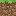
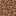
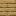
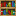
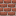
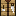
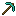
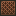
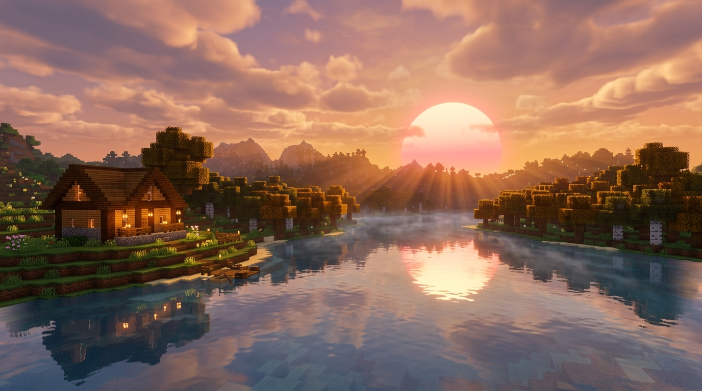

<div align="center">



<br/>

# ⛏️ MSS · Minecraft Simple Server

<a href="#"></a>


**[✨ Features](#-features)** &nbsp;•&nbsp; **[🚀 Quick Start](#-quick-start)** &nbsp;•&nbsp; **[🗺️ Screenshots](#-screenshots)**

<br/>




</div>

<br/>

##  What is MSS?

**MSS** is a cozy local web panel that lets you create, run and manage a Minecraft server right from your PC — no terminal wizardry required. Pick a core, slide the RAM, press **Start**, and invite your friends.

<br/>

##  Features

<table>
<tr>
<td width="50%" valign="top">

 **Any core, any version**<br/>
<sub>Vanilla, Paper, Purpur, Fabric, Forge & NeoForge — downloaded automatically.</sub>

 **Live console**<br/>
<sub>Real-time server logs and commands right in your browser.</sub>

 **Player inspector**<br/>
<sub>See any player's inventory, armor, health, XP and Ender Chest.</sub>

 **Quick player actions**<br/>
<sub>Heal, change gamemode, kick, op — in one click.</sub>

</td>
<td width="50%" valign="top">

 **One-click presets**<br/>
<sub>From a light vanilla world to a heavy modpack — optimal RAM & flags.</sub>

 **Mods & plugins**<br/>
<sub>Drag & drop `.jar` files, toggle or delete them instantly.</sub>

 **Cozy sounds**<br/>
<sub>Soft original Minecraft sound effects for every action.</sub>

 **Minecraft look**<br/>
<sub>Pixel UI, floating particles, light / dark mode, EN / RU.</sub>

</td>
</tr>
</table>

<br/>

##  Quick Start

> [!TIP]
> You only need **Python 3.10+** and **Java** installed.

**1.** Download the project:

```bash
git clone https://github.com/GL1NoMe5/minecraft-simple-server.git
```

**2.** Double-click **`install.bat`** — it sets everything up for you.

**3.** Next time just double-click **`run.bat`** — the panel opens at `http://127.0.0.1:8000` ⛏️

<details>
<summary><b>📦 Want a single .exe instead?</b></summary>

<br/>

Double-click **`build_exe.bat`** — you'll get **`dist/MSS-Launcher.exe`**.
Put it in any folder and run it. Worlds and settings are saved next to the `.exe`.

</details>

<details>
<summary><b>☕ Which Java do I need?</b></summary>

<br/>

| Minecraft | Java |
| :-- | :-- |
| 1.20.5 and newer | **Java 21** |
| 1.18 – 1.20.4 | **Java 17** |
| 1.16.5 and older | **Java 8** |

Get it free at [adoptium.net](https://adoptium.net/).

</details>

<br/>

##  Screenshots

<div align="center">


<sub><b>Player inventory inspector</b></sub>

<br/><br/>

<table>
<tr>
<td width="50%"><p align="center"><sub><b>Live console</b></sub></p></td>
<td width="50%"><p align="center"><sub><b>Core & resources</b></sub></p></td>
</tr>
<tr>
<td colspan="2"><p align="center"><sub><b>Mods & plugins</b></sub></p></td>
</tr>
</table>

</div>

<br/>

##  How it works

<div align="center">

<table>
<tr>
<td align="center" width="25%"><br/><b>1. Pick a core</b><br/><sub>Paper, Fabric, Forge…</sub></td>
<td align="center" width="25%"><br/><b>2. Tune it</b><br/><sub>RAM, CPU, render distance</sub></td>
<td align="center" width="25%"><br/><b>3. Press Start</b><br/><sub>MSS downloads & launches</sub></td>
<td align="center" width="25%"><br/><b>4. Play!</b><br/><sub>Invite friends & have fun</sub></td>
</tr>
</table>

</div>

<br/>

##  FAQ

<details>
<summary><b>Can my friends join from other networks?</b></summary>
<br/>
Yes — use a VPN like Radmin VPN / Hamachi, or a tunnel like playit.gg, and share the address with friends.
</details>

<details>
<summary><b>Where are my worlds saved?</b></summary>
<br/>
Everything lives in the <code>server_data/</code> folder next to the panel. Back it up anytime.
</details>

<details>
<summary><b>I get kicked for "flying" when using mod items!</b></summary>
<br/>
MSS enables <code>allow-flight</code> by default, so jetpacks, rings and grappling hooks work fine.
</details>

<details>
<summary><b>Can I switch the panel to Russian?</b></summary>
<br/>
Sure — hit the <b>EN / RU</b> button in the top bar.
</details>

<br/>

<div align="center">

<table>
<tr>
<td></td>
<td></td>
<td></td>
<td></td>
<td></td>
<td></td>
<td></td>
<td></td>
<td></td>
</tr>
</table>

<i>“The best adventures start with a single block.”</i><br/>
<sub>⭐ If MSS made your evening cozier — drop a star on the repo!</sub>

</div>

<br/>

---

<div align="center">


<sub>Made with ❤️ for players who just want to play with friends.</sub><br/>
<sub><i>Not affiliated with Mojang or Microsoft. Minecraft is a trademark of Mojang Studios.</i></sub>

<br/><br/>



</div>
