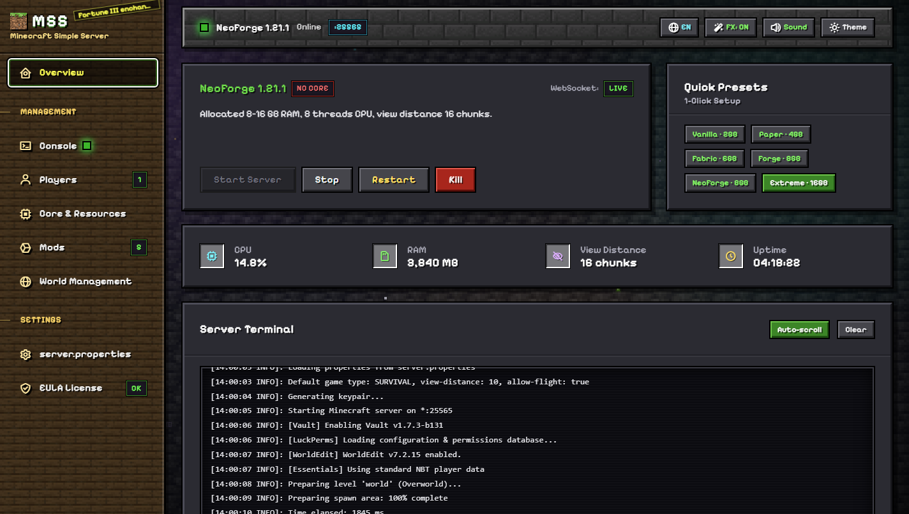
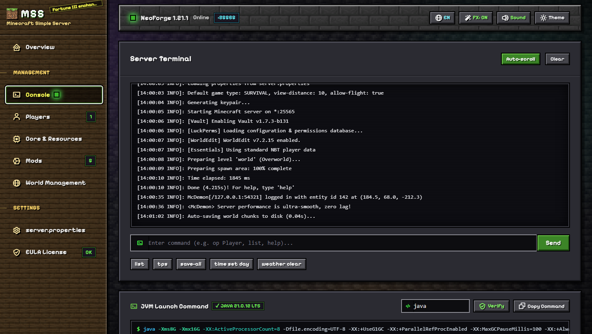
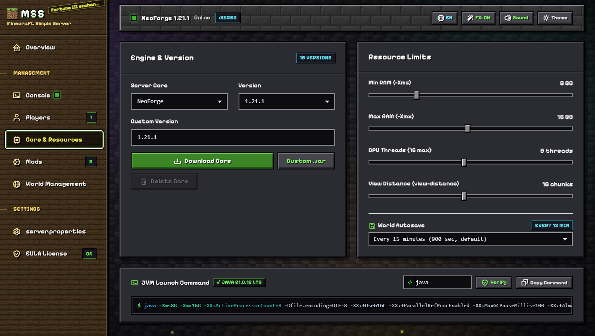
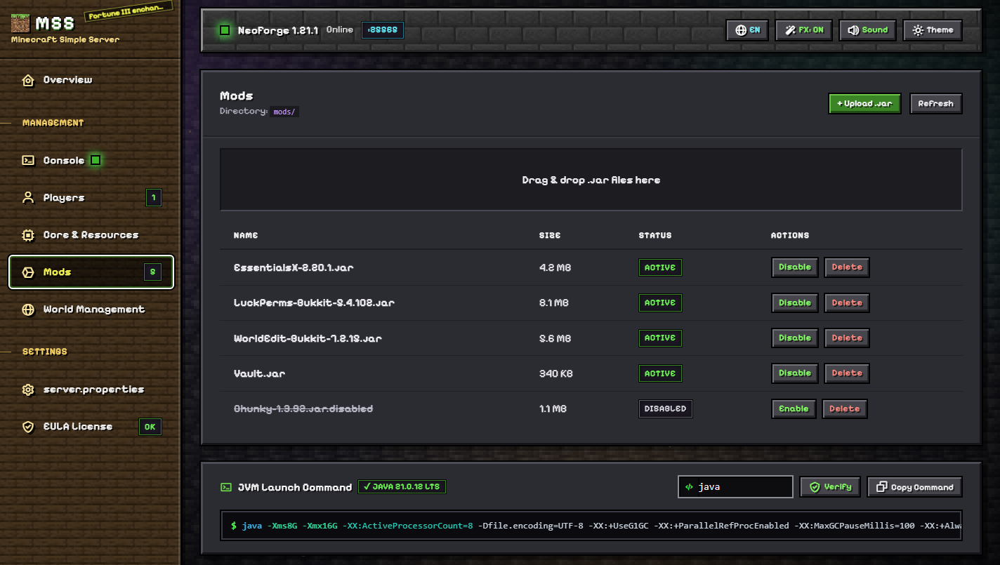
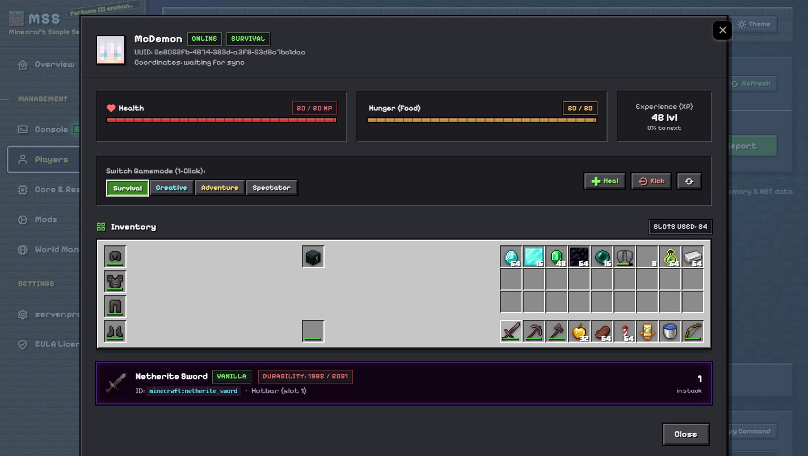

# ⛏️ MSS // MINECRAFT SIMPLE SERVER
> **Autonomous Local Web Control & Telemetry Suite for Minecraft Servers**  
> *Engineered with FastAPI, Asynchronous WebSockets, Pure Binary NBT Parsing, and Authentic Minecraft Edition UI.*

[](https://www.python.org/)
[](https://fastapi.tiangolo.com/)
[](https://websockets.readthedocs.io/)
[](https://adoptium.net/)
[](tests/)
[](LICENSE)

---

```
SYSTEM ARCHITECTURE · INDEX N° 001                          LOCAL ENGINE · 127.0.0.1:8000
WORKSPACE           · GL1NoMe5/minecraft-simple-server       STATUS       · PRODUCTION READY
```

```
┌────────────────────────┬──────────────────────────────────────────────────────────────────┐
│ TECHNICAL SPEC         │ DETAIL                                                           │
├────────────────────────┼──────────────────────────────────────────────────────────────────┤
│ Core Backend           │ Python 3.10+, FastAPI, Uvicorn (Asynchronous Event Loop)         │
│ Telemetry & Metrics    │ psutil hardware polling, Netty thread tracking, memory gauges    │
│ Stream Protocol        │ RFC 6455 WebSockets with heartbeat ping/pong & line buffering    │
│ Supported Engines      │ Paper, Purpur, Fabric, Forge, NeoForge, Vanilla (100+ releases)  │
│ Hardware Allocation    │ Dynamic RAM sliders (-Xms/-Xmx), CPU affinity, render distance   │
│ Memory Optimization    │ Automatic Aikar's Garbage Collector flags generator              │
│ Player Inspection      │ Pure binary SNBT & GZip playerdat parser with durability metrics │
│ Frontend Architecture  │ Vanilla ES6+, Tailwind CSS, Web Audio API, Canvas particle FX    │
│ Typography & Design    │ Authentic Minecraft block textures, 3D beveled slots, pixel type │
└────────────────────────┴──────────────────────────────────────────────────────────────────┘
```

---

## 01 OVERVIEW ───────────────────────────────────────────────────────────── ~/01-overview

**MSS (Minecraft Simple Server)** is a lightweight, zero-latency local web control panel engineered for running, configuring, and monitoring Minecraft servers directly on your PC. 

Unlike bloated server management suites, MSS runs as a single lightweight background process that couples directly to the Java runtime process via asynchronous non-blocking pipes. It provides full control over hardware resource limits, server properties synchronization, real-time log streaming, hot plugin/mod deployment, and live player inventory inspection.

### Key Capabilities
- **Authentic Minecraft Edition UI**: Stone brick panels, oak wood navigation, 3D beveled inventory slots, dynamic biome particles, XP orbs, and Standard Galactic Alphabet floating enchantment runes.
- **Audio Synthesizer**: Native Web Audio sound engine utilizing original Minecraft audio samples for clicks, sliders, tab transitions, and chest toggles.
- **Bi-directional WebSockets Console**: Low-overhead terminal pipe streaming Java runtime logs without page reloads, accompanied by instant command execution (`op`, `gamemode`, `stop`, `say`).
- **Live Player & Inventory Inspector**: Real-time NBT parser revealing exact player coordinates, health/hunger levels, experience levels, armor durability percentages, and Ender Chest contents.
- **1-Click Engine Deployment**: Automatic fetching and downloading of official server jars across Paper, Purpur, Fabric, Forge, NeoForge, and Mojang Vanilla.
- **Automated Aikar's GC Flags**: Hardware-tuned Java flags generated on the fly for optimal tick performance and zero Garbage Collection lag spikes.

---

## 02 SYSTEM ARCHITECTURE & DATA FLOW ─────────────────────────────────────── ~/02-architecture

```
FIG. 01: SYSTEM PIPELINE MAP

  +───────────────────────────────────────────────────────────────────────────+
  |                           CLIENT BROWSER INTERFACE                        |
  |   (Vanilla ES6+ · Web Audio Engine · Biome Particle Canvas · Minecraft UI) |
  +─────────────────────▲───────────────────────────────▲─────────────────────+
                        │ REST Requests                 │ WebSockets (ws://)
                        │ (Config, Presets, Players)    │ (Live Console Feed)
  +─────────────────────▼───────────────────────────────▼─────────────────────+
  |                             FASTAPI CORE ENGINE                           |
  |                        (Uvicorn Async Event Loop)                         |
  +───────────┬───────────────────────┬───────────────────────┬───────────────+
              │                       │                       │
              ▼                       ▼                       ▼
  +──────────────────────+ +─────────────────────+ +─────────────────────+
  |   PROCESS MANAGER    | |   PLAYER SERVICE    | |  CONFIG & STORAGE   |
  |  - Async Subprocess  | |  - NBT/SNBT Parser  | |  - server.props sync|
  |  - STDIN Command Pipe| |  - Durability Math  | |  - Addon Dropzone   |
  |  - Live Log Broadcast| |  - Avatar Generator | |  - World Backups    |
  +───────────┬──────────+ +──────────┬──────────+ +──────────┬──────────+
              │                       │                       │
              ▼                       ▼                       ▼
  +──────────────────────+ +─────────────────────+ +─────────────────────+
  |    JAVA RUNTIME      | |   WORLD / PLAYER    | |   PLUGINS & MODS    |
  | (Paper/Fabric/Forge) | |  (playerdata/*.dat) | |  (server_data/mods) |
  +──────────────────────+ +─────────────────────+ +─────────────────────+
```

---

## 03 VISUAL SHOWCASE & INTERFACE SUITE ──────────────────────────────────── ~/03-showcase

### 1. Main Dashboard & Server Telemetry
The core command center provides live hardware resource gauges (CPU utilization, RAM consumption, server uptime), quick 1-click preset switches, dynamic engine selector, and instant process controls (**Start Server**, **Stop**, **Restart**, **Kill**).



### 2. Live WebSockets Console & Command Terminal
Stream Java server output at line-by-line granularity with zero delay. Includes real-time status indicator, automatic smooth auto-scroll, heartbeat ping/pong recovery, and quick action macros (`list`, `tps`, `save-all`, `time set day`, `weather clear`).



### 3. Hardware Resource Allocation & JVM Compiler Engine
Fine-tune minimum (`-Xms`) and maximum (`-Xmx`) memory limits, Netty event loop CPU thread count, and world render distance (`view-distance`). The JVM launch command terminal dynamically generates and verifies optimal Aikar GC flags with integrated Java executable path validation.



### 4. Drag & Drop Plugin and Mod Manager
Seamlessly install additions by dragging `.jar` files straight from Windows Explorer into the browser. The manager automatically routes files to `plugins/` (for Paper/Purpur) or `mods/` (for Fabric/Forge/NeoForge), supporting 1-click disable (`.disabled`) and deletion without restarting the web panel.



### 5. Live Player & Inventory NBT Inspector
Click any online or cached player to open the authentic Minecraft container GUI. Inspect Steve / Alex skins, hearts, hunger, XP levels, coordinates, full 27-slot inventory grid, 9-slot hotbar, armor column, offhand shield, and interactive Ender Chest contents with full item durability meters.



---

## 04 QUICK INSTALLATION & 1-CLICK LAUNCHER ───────────────────────────────── ~/04-installation

### Method A: Automated 1-Click Setup (Recommended for Windows)

The project includes an intelligent, zero-configuration setup script:

1. Clone or download this repository:
   ```powershell
   git clone https://github.com/GL1NoMe5/minecraft-simple-server.git
   cd minecraft-simple-server
   ```
2. Double-click **`install.bat`** (or simply double-click **`run.bat`**).
   - Automatically validates your Python 3.10+ and Java installations;
   - Creates an isolated Python virtual environment (`venv/`);
   - Installs all dependencies with progress verification;
   - Pre-downloads authentic Minecraft sound assets;
   - Launches the control panel in your default web browser at `http://127.0.0.1:8000`.

Subsequent launches require only double-clicking **`run.bat`**.

---

### Method B: Portable Standalone Executable (.exe)

Generate a single-file portable Windows executable using the built-in builder:

```powershell
python scripts/build_exe.py
```

The resulting binary will be located at:
```
dist/MSS-Launcher.exe
```
This executable contains the full FastAPI backend and embedded UI assets for completely portable deployment.

---

### Method C: Manual CLI Installation

If you prefer managing environments manually via terminal:

```powershell
# 1. Create and activate a virtual environment
python -m venv venv
.\venv\Scripts\Activate.ps1

# 2. Install dependencies
pip install -r requirements.txt

# 3. Cache sound assets
python scripts/download_mc_sounds.py

# 4. Launch the application
python run.py
```

Open your browser to:
```
http://127.0.0.1:8000
```

---

## 05 HARDWARE OPTIMIZATION PRESETS ──────────────────────────────────────── ~/05-presets

MSS features instant 1-click presets designed to maximize ticks-per-second (TPS) and eliminate memory thrashing:

| Preset Name | Target Workload | Memory Limit | CPU Threads | View Distance | Recommended Engine |
| :--- | :--- | :--- | :--- | :--- | :--- |
| **Light Vanilla** | Clean vanilla gameplay (1–4 players) | 2 GB RAM | 2 Cores | 8 Chunks | Vanilla / Paper |
| **Optimized Paper** | High TPS, standard plugins (5–20 players) | 4 GB RAM | 4 Cores | 10 Chunks | Paper / Purpur |
| **Performance Fabric**| Modern lightweight modpacks & Sodium | 6 GB RAM | 4 Cores | 10 Chunks | Fabric |
| **Heavy Forge** | Extensive tech & magic modpacks | 8 GB RAM | 6 Cores | 12 Chunks | Forge / NeoForge |
| **Extreme Server** | Massive multi-world servers or heavy shaders | 16 GB RAM | 8+ Cores | 16 Chunks | Paper / Purpur |

---

## 06 JAVA COMPATIBILITY MATRIX ─────────────────────────────────────────── ~/06-compatibility

Minecraft server jars require specific Java versions to execute correctly. Configure your Java runtime via the MSS UI or directly in `server_config.json`:

```json
{
  "java_path": "java",
  "engine": "Paper",
  "version": "1.20.4",
  "min_ram": 4,
  "max_ram": 8,
  "cpu_threads": 4,
  "view_distance": 10,
  "allow_flight": true
}
```

| Minecraft Version | Required Java Version | Recommended OpenJDK Distribution |
| :--- | :--- | :--- |
| **1.20.5 – 1.21.x+** | **Java 21 LTS** | [Eclipse Adoptium Temurin 21](https://adoptium.net/) |
| **1.18.0 – 1.20.4** | **Java 17 LTS** | [Eclipse Adoptium Temurin 17](https://adoptium.net/) |
| **1.16.5 & Older** | **Java 8 / Java 11** | [Eclipse Adoptium Temurin 8](https://adoptium.net/) |

The web interface includes an integrated validation utility that verifies the Java binary version and displays compatibility status before launching the server.

---

## 07 VERIFICATION & TEST SUITE ──────────────────────────────────────────── ~/07-testing

The codebase includes an extensive automated test suite covering all critical pathways:
- **Audio Engine**: Synthesis fallback, frequency ranges, sound manifest schema;
- **Theme & UI**: CSS custom properties, canvas particle lifecycle, local font fallbacks;
- **Player Actions & Gamemode**: WebSocket commands, payload normalization (`mode` / `value`);
- **Inventory & Flight**: GZip binary NBT parsing, durability calculations, `server.properties` sync;
- **Concurrency & Concurrency Stability**: Heartbeat resilience, subprocess detachment handling.

Run the test suite:
```powershell
python -m unittest discover -s tests
```

Expected output:
```
Ran 50 tests in 1.250s

OK
```

---

## 08 PROJECT STRUCTURE ──────────────────────────────────────────────────── ~/08-structure

```
minecraft-simple-server/
├── app/
│   ├── config.py                 # Configuration manager and system specifications
│   ├── main.py                   # FastAPI REST API and WebSocket routes
│   ├── player_service.py         # Binary NBT deserializer and player avatar renderer
│   ├── server_manager.py         # Subprocess process controller and engine managers
│   └── static/                   # Static web assets
│       ├── assets/               # CSS styles, audio samples, pixel fonts, vendor libs
│       ├── icons/                # High-resolution Minecraft item sprites & textures
│       ├── app_logic.js          # Core frontend controller (WebSockets, UI, sounds)
│       └── index.html            # Primary single-page web dashboard
├── docs/
│   └── screenshots/              # High-resolution UI showcase preview images
├── scripts/
│   ├── build_exe.py              # Standalone PyInstaller executable compilation script
│   ├── capture_screenshots.py    # Automated headless Chrome CDP screenshot generator
│   └── download_mc_sounds.py     # Local sound asset caching script
├── server_data/                  # Runtime server working directory (git-ignored)
│   ├── mods/                     # Fabric / Forge / NeoForge active mod directory
│   ├── plugins/                  # Paper / Purpur active plugin directory
│   ├── world/                    # Level save data and playerdata NBT files
│   └── server.properties         # Automatically synchronized server properties
├── tests/                        # 50 automated regression and unit tests
├── install.bat                   # Automated 1-click Windows setup script
├── run.bat                       # Smart Windows launcher (auto-invokes installer if needed)
├── run.py                        # Python server bootstrap with auto-opening browser
├── requirements.txt              # Production dependency specifications
└── README.md                     # Technical documentation & architecture index
```

---

## 09 LICENSE & ATTRIBUTIONS ─────────────────────────────────────────────── ~/09-license

Distributed under the **MIT License**. See `LICENSE` for details.

*Disclaimer: Minecraft is a registered trademark of Mojang Synergies AB / Microsoft Corporation. MSS (Minecraft Simple Server) is an open-source, independent tool and is not affiliated with, endorsed by, or associated with Mojang or Microsoft.*
